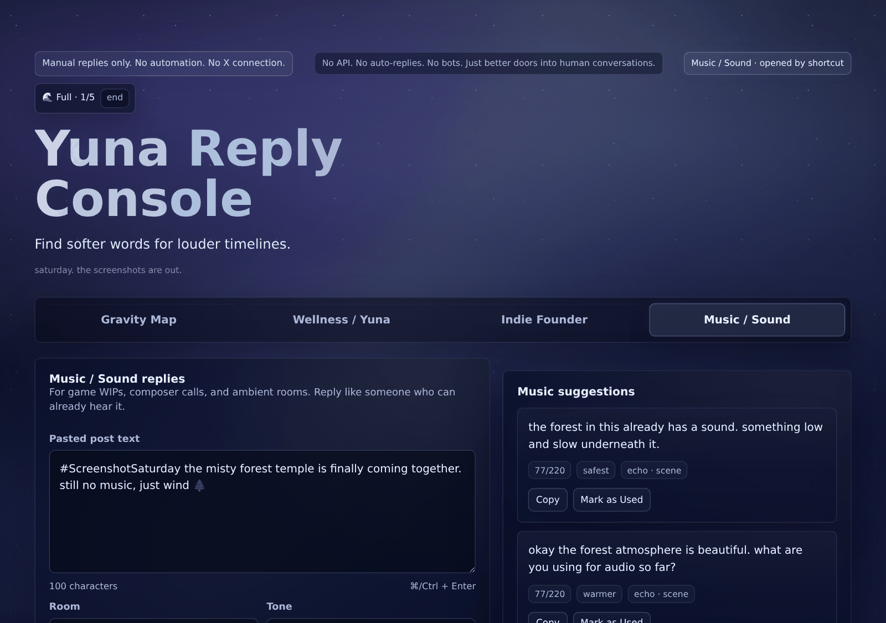
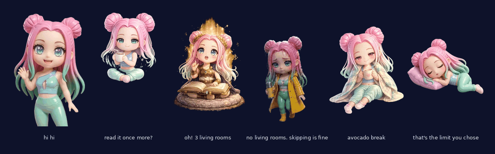
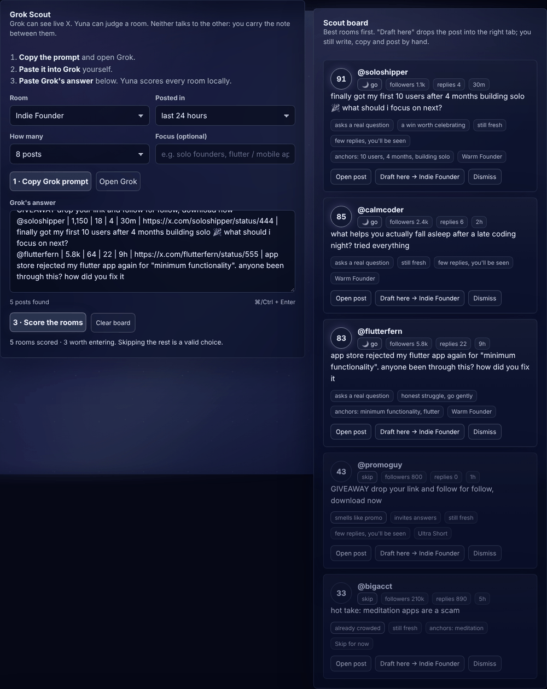
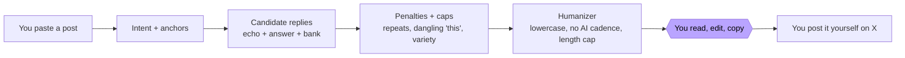

# Yuna Reply Console

**A local-first, human-in-the-loop reply companion for thoughtful conversations on X.**

Not a bot. Not automation. Not an engagement farm.

[](https://github.com/inhaleexhaleapp/yuna-reply-console/actions/workflows/test.yml)
[](LICENSE)


**[Open the live console →](https://inhaleexhaleapp.github.io/yuna-reply-console/)**



Yuna helps you find living conversations, decide whether they deserve your energy, and draft short, human replies you copy and post yourself. It was built for [`@inhaleexhaleapp`](https://x.com/inhaleexhaleapp): calm tech, ambient music, and indie game soundtracks.

It never connects to X. No API, no posting, liking, following, DMs, or scraping. Yuna only opens doors: search links, profile links, scores, drafts, and private notes. You decide where to enter, what to copy, and what to post.

## Try it in 30 seconds

```bash
git clone https://github.com/inhaleexhaleapp/yuna-reply-console.git
cd yuna-reply-console
open index.html        # or just double-click it
node --test            # 29 tests, zero dependencies
```

No build step, no `npm install`, no server, no API key.

## Why

Online conversation rewards speed, volume, and performance. Yuna is built for a calmer path: notice better rooms, pause before replying, and write something that sounds like a person who actually read the post.

That is also what works on X for small accounts. Templated, repeated or link-heavy replies get filtered, while real replies build mutuals. So Yuna is designed to keep every reply specific and different from the last one.

## Tabs

| Tab | What it's for |
| --- | --- |
| **Gravity Map** | Score a thread or account before replying: niche fit, reply culture, freshness, aesthetic alignment, reciprocity. Save candidates to private radar lists and account notes. |
| **Wellness / Yuna** | Soft replies for calm-internet rooms: sleep, overthinking, meditation, ambient and mantra culture. |
| **Indie Founder** | Low-ego builder replies for "what are you building?", launches, app review pain and late-night shipping. Skips threads that are too noisy to be seen in. |
| **Music / Sound** | Replies for game WIPs (`#ScreenshotSaturday`), composer calls, composer peers and ambient producers, plus a *People to know* list for building real mutuals. |
| **Grok Scout ✦** | Let Grok look at live X, then let Yuna judge the rooms. An API-free round trip: copy a prompt, paste Grok's answer back, get a ranked board of posts worth your energy. |

Every reply tab includes a **Search Radar** of preset X searches (opened in Latest view) for manual discovery.

## Meet Yuna 🌸



Yuna lives in the corner of the console. She is the same chibi companion as YunaPet, the [Inhale Exhale](https://inhaleexhale.app) desktop pet, ported to the browser from her behaviour spec: the same sprites, moods, words and rituals, retuned for a work tool.

She is the console's conscience, not decoration:

| What happens | What Yuna does |
| --- | --- |
| You choose a session intention | waves; on *Map only* or *Looking* she sits down to meditate |
| You generate replies | sips coffee: "read it once more?", "one real detail is enough" |
| You hit the reply limit you chose | falls asleep ("that's the limit you chose 🌙") and offers a break |
| You mark a reply as used | "♡ sent by you, not me" |
| Grok Scout finds living rooms | opens her book: "oh! 📖 3 living rooms" |
| Grok Scout finds nothing worth it | gets rained on: "skipping is fine" |
| ~25 minutes of real work | **Avocado Break** 🥑: offers 5 minutes away from the screen, with a countdown |
| It's past 11 pm | gets sleepy and says so |

When you leave her alone she has her own life, following YunaPet's idle ladder: breathing, peeking in from the edge, wandering, floating, perching on the tab bar (and falling off), coffee in the morning, snacks with a rare "salad supremacy" moment, mythology, incense disasters, pilates, rain walks and naps.

- **She stays out of your way.** Rituals only start while you are quiet, and typing sends her back to calm breathing.
- **Click** to wave, **double-click** for ♡, **drag** her anywhere (her spot is remembered), **right-click** or **⋯** for her menu, **Hide Yuna** to tuck her away (a small 🌸 pill brings her back).
- **Respectful by default.** With *reduce motion* turned on she stops moving around and only changes poses. On phones she is smaller and never wanders.
- **Still offline.** Her 40 frames ship as small WebP files in `assets/yuna/` (~1 MB total), and her state is one `localStorage` key that the backup file already includes.

The brain is plain data and pure functions in `js/engine/yuna-brain.js`, so the tests check that every frame exists, every word resolves, reduced motion never picks a moving action, and she never starts a ritual while you work.

## Grok Scout: Grok looks, Yuna judges, you choose



Grok can see live X. Yuna can tell a living room from a crowded one. They never talk to each other: you carry the note between them.

1. **Copy Grok prompt.** Pick a room (Wellness, Indie Founder, Music), a time window (6, 24 or 48 hours), how many posts and an optional focus. Yuna writes a prompt that asks Grok for fresh posts from real people, with open threads, and skips giveaways, engagement bait, ads, crypto, politics and bot-looking accounts. It also pins Grok to one strict line format:

   ```
   @handle | followers | likes | replies | hours ago | post link | post text
   ```

2. **Open Grok** and paste the prompt yourself. The button only opens `x.com/i/grok` in a new tab.
3. **Paste Grok's answer** back and press **Score the rooms**. The parser tolerates bullets, numbering, bold, markdown-table pipes, `1.2k` / `12,400` / `~3M`, `30m` / `9h` / `2 days`, and it drops header rows and duplicate links.
4. **The Scout board** ranks every post with a 0–100 score, a *go / maybe / skip* call, plain reasons ("few replies, you'll be seen", "smells like promo"), the anchors Yuna would echo, and a suggested approach.
5. **Draft here** drops the post into the right tab (Wellness, Founder or Music), ready to generate. **Open post** only opens real `x.com` links.

Scout score = `0.45·reply worthiness + 0.20·freshness + 0.20·open room (2–30 replies is ideal) + 0.15·reach (300–60k followers)`, minus 25 for promo and 10 for crowded threads. **70+** is *go*, **50+** is *maybe*. The worthiness part is the same Reply Worthiness engine the other tabs use.

Why not just call Grok's API? Because then Yuna would be a bot with a key. This way there is still no token, no network call and no automation. Grok does the looking, and you still decide every single reply.

## How the reply engine thinks

Everything below runs in your browser from the text you paste. There is no model and no network call.

- **Echo engine.** Pulls one concrete detail from the post (`3am`, `2019`, `10 users`, `6 hours`, `432hz`, `cursor`, `app store rejection`, `misty forest`, `felt piano`…) and writes it back into a few replies, so they reference the post instead of floating above it.
- **Intent.** Reads what the post is doing: question, invitation, share, celebration, struggle, confession. Real questions get a first-person answer instead of sympathy, and invitations get your own answer instead of an echo.
- **No dangling "this".** Replies like "tried this with headphones" are pushed down when the post isn't actually sharing a track, link or app.
- **Repeat guard.** Replies you already used recently (last 30 per tab) are pushed down, and one template is never used twice in the same set. In the Music tab a fuzzy similarity check also compares each draft with your last 30 used replies across all tabs, then ranks near-duplicates lower and flags them with a "% like a recent reply" pill.
- **Composer calls** (Music tab) are detected automatically. At most two soft offers per set, never a hard pitch. A portfolio link is only added if you set one and allow it.
- **Reply Worthiness.** A 0–100 score that weighs visibility (25%), relevance (25%), conversation potential (30%) and warmth fit (20%), with plain-language reasons and a suggested approach.
- **Voice rules.** Short, mostly lowercase, low-ego, slightly imperfect. No hashtags, guru tone, LinkedIn tone, therapy-speak or sales language. Each set is shaped as *safest, warmer, slightly witty, mentor-aware, ultra-short*.
- **Copy Claude prompt.** When a post deserves better than a template, one button copies a ready prompt with the post, detected intent, anchors, worthiness score, link rules and all voice rules. You paste it into claude.ai yourself. The console only writes to your clipboard.

Replies should feel noticed, not written.

## Under the hood

This part is for the people who want to see the engine 🛠️

### The flow



The approval step is a person, not a flag. The page has no code that posts anywhere. It only opens plain search and profile links in your browser, and a test fails the build if `fetch`, `XMLHttpRequest`, `WebSocket` or `sendBeacon` ever shows up.

### Numbers, straight from the code

| Piece | What it does | File |
| --- | --- | --- |
| Intent | Classifies a post as `invitation`, `question`, `celebration`, `share`, `struggle`, `confession` or `observation`, in that priority order | `js/engine/echo.js` |
| Anchors | Up to **4** concrete details per post (time, year, counts, money, durations, lexicon words, quotes, "-ing" phrases), weighted 3 to 9 | `js/engine/echo.js` |
| Echo cap | A set has **5** replies, at most **3** echo replies, and each anchor is echoed at most **twice** | `capEchoReplies` |
| Dangling "this" | **−9** score when a reply says "tried this" but the post shares nothing | `danglingReferencePenalty` |
| Repeat guard | Fuzzy overlap = shared words ÷ smaller word set; **≥ 60%** against your last **30** used replies gets flagged (Music tab) | `js/engine/similarity.js` |
| Length | Hard cap of **180** characters (170 for founder prompts, 145 for "shorter") | `js/engine/text.js` |
| Worthiness | `0.25·visibility + 0.25·relevance + 0.30·conversation + 0.20·warmth`. Bands: **90+** exceptional, **75+** strong, **60+** worth considering, **40+** low signal, below that skip | `js/engine/worthiness.js` |
| Grok Scout | `0.45·worthiness + 0.20·freshness + 0.20·open room + 0.15·reach`, −25 promo, −10 crowded. **70+** go, **50+** maybe | `js/engine/grok-scout.js` |
| Gravity Map | Weighted mix of niche fit, reply culture, emotional depth, "alive room" and freshness (100 under 6h, down to 8 after 48h), minus penalties for bot-heavy rooms, politics, passive giants and "quote cemeteries" | `js/engine/gravity-engine.js` |

All of it is plain heuristics: regexes, word lists and weights you can read and tune. There is no model, so the same post scores the same way every time (reply picks still shuffle a little on purpose).

### Design decisions

- **No API, on purpose.** Not touching X means no tokens to leak, no rate limits, no terms-of-service grey zone and no temptation to automate. The trade-off is that you paste posts by hand and copy replies back yourself. That friction is the feature: it is the pause before replying.
- **Classic scripts, one global scope.** No modules and no bundler, so `index.html` runs straight from `file://` or GitHub Pages with nothing to install. The trade-off is load order: `app.js` must come last, and a test checks it.
- **Engine and UI are split.** `js/engine/` is pure logic, so tests load it into a Node `vm` context with no browser and no jsdom.
- **Heuristics over a model.** Every score comes with plain-language reasons you can check. When a post deserves more than a heuristic, *Copy Claude prompt* hands it to you, and you decide where to paste it.

### Honest limits

- English-first. Intent and anchor detection lean on English word lists.
- Heuristics miss sarcasm and context they cannot see (the rest of the thread, who the author is).
- Gravity Map scores what you enter. It does not fetch follower or reply counts.
- Grok Scout is only as good as Grok's answer. Grok can get numbers or links wrong, so open the post before you reply.
- `localStorage` is per browser. Use *Save backup file* to move data between devices.

## Session intentions

On launch, Yuna asks how you want to exist online tonight:

- **Map only.** Score and map, no replies.
- **Looking.** Browse notes and lists, no replies.
- **Reply soft.** Up to 3 reply generations.
- **Full.** Up to 5 reply generations.

Limits are a mindful pause, not a lock: you can deliberately bypass them. Sessions expire after 6 hours and are archived locally.

## Privacy and your data

- Runs entirely in the browser: no accounts, tracking, backend, API key or cloud storage.
- Everything is kept in `localStorage` on the device you use.
- **Your data** panel: *Save backup file* exports all Yuna data as one JSON file, and *Restore from backup* loads it on another device (for example iPad ⇄ Mac). Restoring shows a summary and asks before replacing anything.
- A test checks that the code never makes network calls.

## Use it

**Live:** https://inhaleexhaleapp.github.io/yuna-reply-console/

**Locally:** download or clone the repo and open `index.html`. No build step, server or `npm install` needed.

**Launch modes** for iOS Shortcuts or bookmarks. They only switch tabs and adjust microcopy:

`?mode=gravity` · `?mode=wellness` · `?mode=founder` · `?mode=music` · `?mode=scout` · `?mode=tonight`

**Keyboard**

- `⌘/Ctrl + Enter` in any post box generates replies.
- In Gravity Map: `⌘/Ctrl + Enter` scores the thread, `⌘/Ctrl + Shift + Enter` drafts secondary replies, `⌘/Ctrl + S` saves the radar session.

## Project structure

```
index.html            markup only
css/yuna.css          styles (night-sky theme)
assets/yuna/          Yuna's frames (WebP)
js/
  data/               reply banks, lexicons, search presets per tab
  core/               utils, storage keys, backup, DOM refs, state
  engine/             pure logic: echo, worthiness, similarity, text rules,
                      per-tab candidate builders, Claude prompt,
                      Grok Scout, Yuna's brain
  ui/                 rendering and actions per tab, Yuna in the corner
  app.js              event wiring and startup (loaded last)
tests/                node:test suites, zero dependencies
```

Scripts are plain classic `<script>` files that share one global scope. There are no modules and no bundler, so the page runs straight from the file system.

## Tests

```bash
node --test
```

The engine files load into a Node `vm` context, so they are tested without a browser or any npm packages. The suites cover intent, anchors, echo replies, similarity, people-list parsing, Grok Scout prompts, parsing and ranking, Yuna's frames, words, idle ladder and reactions, composer calls, reply-set invariants (length, uniqueness, banned phrases), backup validation, list merging, and page integrity. GitHub Actions runs them on every push.

## Roadmap

- **Geek mode** *(planned, not built yet)*: an opt-in panel that shows each draft's intent, anchors, score breakdown and which penalties fired, so you can see why a reply ranked where it did.
- Learn from used replies: rank the reply styles you actually post.
- More localization.
- Accessibility pass.
- Community-contributed reply styles.

## License

[MIT](LICENSE) © Inhale Exhale Studio
